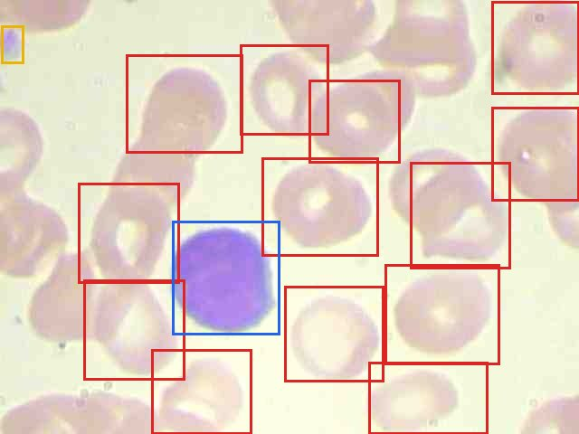

# 🩸 BCCD Blood Cell Detection Challenge

## 👉 [**Open the competition website**](https://mahatrabelsi1.github.io/BCCD/) · [**See the leaderboard**](https://mahatrabelsi1.github.io/BCCD/#leaderboard)

Find every **red blood cell (RBC)**, **white blood cell (WBC)** and **platelet** in noisy microscope images.
Train your model on your own computer, send your predictions with a Pull Request, and a bot gives you your score
and your rank in about 2 minutes.

<p align="center">
  
  <br><sub>🟥 RBC &nbsp; 🟦 WBC &nbsp; 🟨 Platelets</sub>
</p>

| | |
|---|---|
| 🎯 **Task** | Draw a box around every cell and say which type it is |
| 🖼️ **Images** | 205 train · 87 validation · 72 test (answers hidden). Most images have added noise |
| 📏 **Score** | **mAP@0.5**, from 0 to 1, higher is better |
| 📨 **Submissions** | **Only 1 per team**, so test on validation first! |

---

## 🚀 How to join (5 steps)

### 1. Get the data

Click **Fork** (top right of this page), then download your copy:

```bash
git clone https://github.com/<your-username>/BCCD.git
cd BCCD
pip install -r requirements.txt
```

Everything you need is in `data/public/`:

| File | What's inside |
|---|---|
| `train/images/`, `val/images/` | Training and validation images |
| `train_annotations.csv`, `val_annotations.csv` | The boxes for those images: `image_id,label,xmin,ymin,xmax,ymax` |
| `test/images/` | The 72 images you must predict (no answers given) |
| `sample_submission.csv` | An example of the file you will submit |

### 2. Train a model and predict the test images

Use any method you like. To get started fast, run the ready-made baseline (Faster R-CNN):

```bash
pip install torch torchvision
python starter/baseline_fasterrcnn.py --epochs 20
```

It prints your **validation score** and writes your test predictions to `starter/out/predictions.csv`.
A GPU is much faster; free GPUs on Google Colab or Kaggle work well.

### 3. Check your file

Your `predictions.csv` must look like this, with one row per box:

```csv
image_id,label,score,xmin,ymin,xmax,ymax
bccd_0002,RBC,0.97,412,88,515,190
bccd_0002,WBC,0.99,201,150,330,281
bccd_0002,Platelets,0.64,55,402,82,431
```

- `label` is `RBC`, `WBC` or `Platelets`
- `score` is your confidence, between 0 and 1
- `xmin,ymin,xmax,ymax` are the box corners, in pixels

Check it:

```bash
python scoring/validate_submission.py predictions.csv
```

💡 **Tip:** you only get one real submission, so check your score on validation first. Run your model on the
`val` images and do:
```bash
python scoring/score_submission.py --pred my_val_predictions.csv --split val
```
This uses exactly the same scoring as the bot.

### 4. Encrypt it and add 2 files

Encrypt your predictions so nobody else can see them:

```bash
python encryption/encrypt.py predictions.csv encryption/public_key.pem predictions.csv.enc
```

Create a folder with **your team name** and a **run name**, and put 2 files in it:

```text
submissions/inbox/<your_team>/<run_name>/
├── predictions.csv.enc     ← the encrypted file from above
└── metadata.json           ← who you are
```

`metadata.json` (copy [`metadata_template.json`](submissions/inbox/metadata_template.json)):

```json
{
  "team": "your_team",
  "run_id": "run_01",
  "author_type": "human",
  "model": "Faster R-CNN",
  "notes": "anything you want to say about your method"
}
```

- `team` and `run_id` must be **exactly** the folder names. Use letters, numbers, `_`, `-` or `.` only, no spaces.
- `author_type`: `human` (you wrote it), `llm` (an AI wrote it) or `hybrid` (both).
- ⚠️ Do **not** upload the plain `predictions.csv`, only the `.enc` file.

### 5. Send it

```bash
git add submissions/inbox/<your_team>
git commit -m "Submission: <your_team>"
git push
```

Then on GitHub, click **Contribute → Open pull request → Create pull request**.

✅ In about 2 minutes, the bot comments your score and rank on the pull request and you appear on the
[**leaderboard**](https://mahatrabelsi1.github.io/BCCD/#leaderboard). The pull request then closes by itself.
That's normal: there is nothing to merge.

<details>
<summary><b>No git? Submit from the GitHub website instead</b></summary>

1. On **your fork**, click **Add file → Create new file**.
2. Type the name `submissions/inbox/<your_team>/<run_name>/metadata.json`. The `/` creates the folders.
   Paste your metadata and click **Commit changes**.
3. Click into that new folder, then **Add file → Upload files**, upload `predictions.csv.enc`, and commit.
4. Click **Contribute → Open pull request → Create pull request**.

</details>

---

## ❓ Something went wrong?

If your submission has a problem, the bot **comments the reason** on your pull request and leaves it open.
Fix it and push again to the **same** pull request. It is re-checked automatically and still counts as one submission.

| Bot message | What to do |
|---|---|
| *Could not decrypt* | Encrypt with `encryption/public_key.pem` from **this** repo, using `encryption/encrypt.py` |
| *Folder must be submissions/inbox/…* | Make the folder names match `team` and `run_id` in `metadata.json` |
| *may only add predictions.csv.enc and metadata.json* | Your PR changes other files. Only those 2 files are allowed |
| *Columns must be exactly…* / *Invalid label* | Run `python scoring/validate_submission.py predictions.csv` and fix what it says |
| *already has 1 scored submission* | Each team and each GitHub account can only be scored once |

---

## 📏 How the score works

The score is **mAP@0.5**, the standard score for object detection:

- A predicted box **counts as correct** if it overlaps a real cell of the same type by at least 50% (IoU ≥ 0.5).
  Each real cell can only be found once.
- For each cell type, we look at how many cells you found **and** how many of your boxes were wrong,
  from your most confident box to your least confident. That gives one number per type, called the **AP**.
- **Your score = the average of AP for RBC, WBC and Platelets.** The rare WBCs and tiny platelets count
  just as much as the many RBCs.

The exact code is in [`scoring/metrics.py`](scoring/metrics.py).

## 🌫️ About the noise

To make it harder, about 90% of images (in train, validation **and** test) have 1 or 2 of these effects:

| Effect | Looks like |
|---|---|
| Gaussian noise | grainy picture |
| Salt & pepper | small black/white dots, easy to confuse with platelets! |
| Blur | soft, merged cell edges |
| Strong JPEG compression | blocky squares |
| Colour / brightness / contrast change | pink, dark or washed-out images |

Only the pixels changed, so every box is still exactly right. Denoising, data augmentation and robust training are
all allowed.

## 📊 Data numbers

| Split | Images | RBC | WBC | Platelets |
|---|---:|---:|---:|---:|
| train | 205 | 2,381 | 214 | 209 |
| val | 87 | 967 | 87 | 83 |
| test | 72 | hidden | hidden | hidden |

All images are 640×480. Box coordinates are in pixels, with (0, 0) at the top-left corner. The original BCCD
labels sometimes miss a few RBCs, so the labels are not perfect.

## 📜 Rules

1. **One scored submission per team and per GitHub account.**
2. Use only the data in this repo. Pretrained models (ImageNet, COCO) are fine; mention them in `notes`.
3. **Don't use the original BCCD dataset** to find the test answers, and don't label test images by hand.
4. Be honest about `author_type` (human / llm / hybrid).
5. Organizers can remove entries that break the rules.

---

<sub>
Data: <a href="https://github.com/Shenggan/BCCD_Dataset">BCCD Dataset</a> (MIT licence, see <code>data/public/LICENSE_BCCD</code>).
Competition structure adapted from <a href="https://github.com/mahatrabelsi1/GNN-MVP-Node-Classification-Under-Noise">GNN-MVP-Node-Classification-Under-Noise</a>.
Organizers: see <a href="ORGANIZERS.md">ORGANIZERS.md</a>.
</sub>
